# Lumina

[](LICENSE)

**One lamp lights the room.** Lumina is a family of themes for Emacs,
Neovim, VS Code, WezTerm and the terminal, built on a single idea: in
every flavor, one colour is the light (the cursor, the definition you
are reading, the current line, the heading you are in) and everything
else sits in the room at equal weight, never louder than the lamp.

Sixteen flavors, each in dark, light and high contrast: 68 themes. The
flagship is **Sienne**: slate night under warm inks, beige text at
nearly 9:1, one teal lamp on the functions, mauve keywords, gold types,
olive strings, coral constants, apricot builtins. Light: the same hues
as inks on slate paper.
Its cool counterpart is **Vesper**: deep navy at night, blue-lavender
text, blue functions, purple keywords, sky types, straw strings, coral
constants, rose builtins, no green in the code.
**Indigo** keeps one azure for the keywords and desert inks of the same
weight for everything else (gold sand, copper, dusk mauve); **Azur**
sets the same azure among peach, straw, lilac and mint on blue slate.

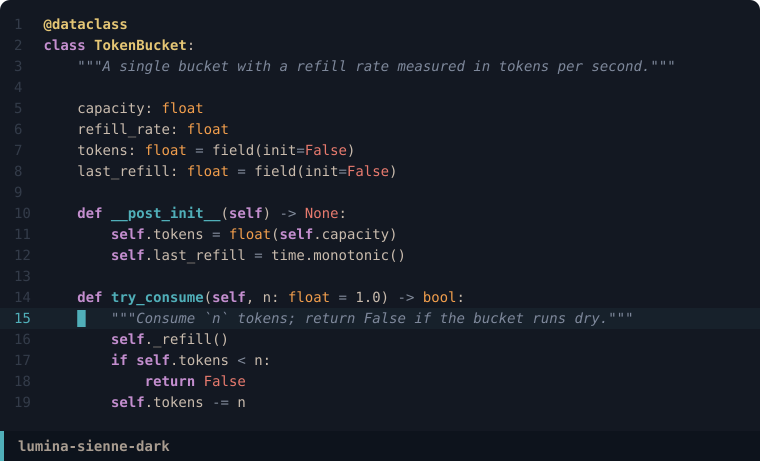 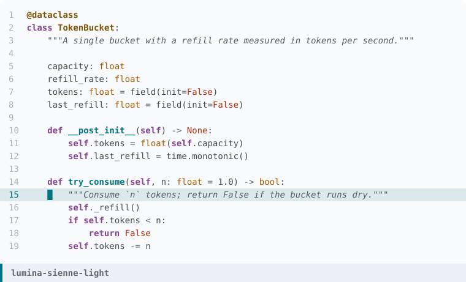

## What makes it different

- **One lamp.** Each flavor has one lead colour, and only the lamp
  glows: cursor, current line number, function definitions, headings,
  mode-line bar, search. Keywords never shout.
- **Public scales, composed here.** Every accent comes from a public
  colour system: Tailwind v4 step 300 on dark grounds, Radix Colors
  step 11 on light paper, both OKLCH-defined. No editor theme or brand
  palette is copied; the composition (ground, lamp, roles) is Lumina's.
- **Equal lightness, one lamp.** Non-lamp accents are clamped to a
  common lightness band and a chroma cap; only the lamp keeps its full
  value. Nothing jumps out by accident, the definitions do on purpose.
- **Soft text.** Body text sits near 9:1, never white on black: the
  range of Tokyo Night, One Dark and Nord, not the 12 to 15:1 of the
  harder themes.
- **Light that follows you.** The lamp tints the current line, the
  selection and the completion candidate, and flashes on every jump.
  With [auto-dim-other-buffers](https://github.com/mina86/auto-dim-other-buffers.el)
  the windows you are not working in fall into shade.
- **Measured, not guessed.** Text sits at 8.6 to 9.7:1, comments at
  4.7:1 or more, every accent at 4.5:1 or more, on its own tinted ground
  at 4:1 or more. `make check` refuses a
  palette that drifts, and `tools/explore/audit.py` refuses two code roles
  closer than 8 dE, a lamp closer than 9 to any role, an error red closer
  than 10, or a second warm note beside the lamp.
- **High contrast built in.** Every theme ships a `-contrast` twin:
  text 15:1 or more, comments 6:1, every accent 7:1 (WCAG AAA), same
  lamp, same hues.
- **Readable diffs.** Added, removed and changed lines sit on tinted
  grounds in magit, diff, smerge and ediff.
- **Complete coverage.** Close to 3 000 faces per theme, written against
  the real `defface` names of Emacs 30 and of the installed packages:
  org and org-modern, magit and forge, vertico, corfu, company, consult,
  marginalia, embark, ivy and helm, treemacs and dirvish, lsp-mode,
  lsp-ui, dap and eglot, tree-sitter, flycheck and flymake, meow and
  evil, vterm, eat and term, mu4e, gnus and notmuch, elfeed and erc,
  markdown, LaTeX and web-mode, doom-modeline and nano-modeline,
  transient, which-key, avy, and more. Popups sit on their own ground,
  every state has a tinted ground, and `hl-todo`, `vc-annotate`,
  `pdf-tools` and `rustic` variables follow the palette.

## Flavors

Each flavor covers one colour group: one ground, one lamp, one role map.
Dark grounds are Radix app backgrounds (step 2 of the flavor's hue) or the
Tailwind neutral that carries the same temperature, and carry Tailwind
pastels; light paper is always the Radix step 2 of the hue, and carries
Radix inks.

| Flavor | Ground | Lamp | Keywords, types, strings | Note |
|---|---|---|---|---|
| **Sienne** | slate night / slate paper | teal | mauve, gold, olive | coral, apricot |
| **Vesper** | deep navy / cool white | blue | purple, sky, straw | coral, rose |
| **Indigo** | indigo night / lavender paper | azure | gold sand, copper, dusk mauve | none |
| **Azur** | blue slate / cool paper | azure | peach, lilac, straw | mint |
| **Dawn** | warm sepia | amber | terracotta, teal, lime | rose |
| **Oxblood** | dark wine | rose | violet, amber, emerald | orange |
| **Tide** | deep ocean | sky | teal, indigo, emerald | amber |
| **Canopy** | pine | leaf green | teal, amber, sky | orange |
| **Slate** | cold graphite | steel blue | sky, violet, emerald, all held back | orange |
| **Nocturne** | indigo night | sodium orange | violet, sky, emerald | amber |
| **Amethyst** | purple geode | citrine | orchid, jade, periwinkle | none |
| **Prisma** | neutral indigo | ultraviolet | emerald, teal, sky; full-spectrum delimiters | orange; black-and-white `-ink` twins |
| **Sirocco** | terracotta | sky | sand, sage, orchid | the only cool light is the lamp |
| **Celadon** | jade porcelain | peach | sky, jade, orchid | none |
| **Sumi** | ink black / rice paper | vermilion seal | matcha, plum, sky, all whispered | none |
| **Pivoine** | soft peony dusk, lighter than the night grounds | mint | peony, periwinkle, sky | apricot |

### Gallery

**Vesper**

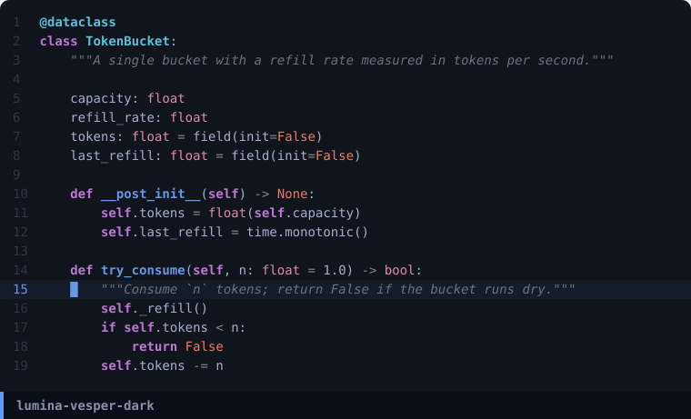 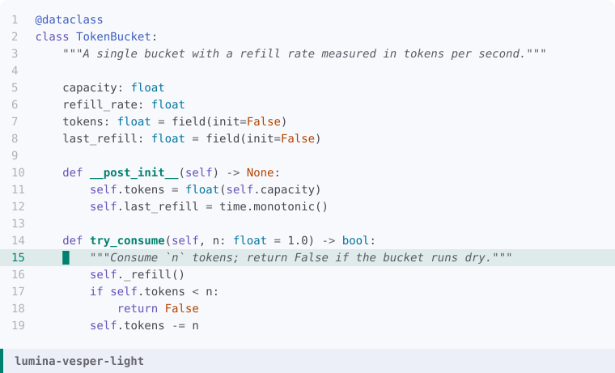

**Dawn**

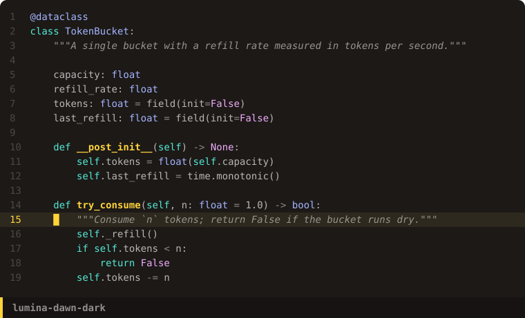 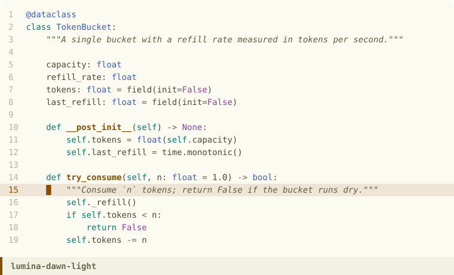

**Oxblood**

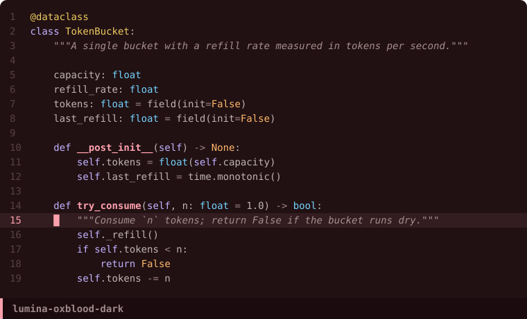 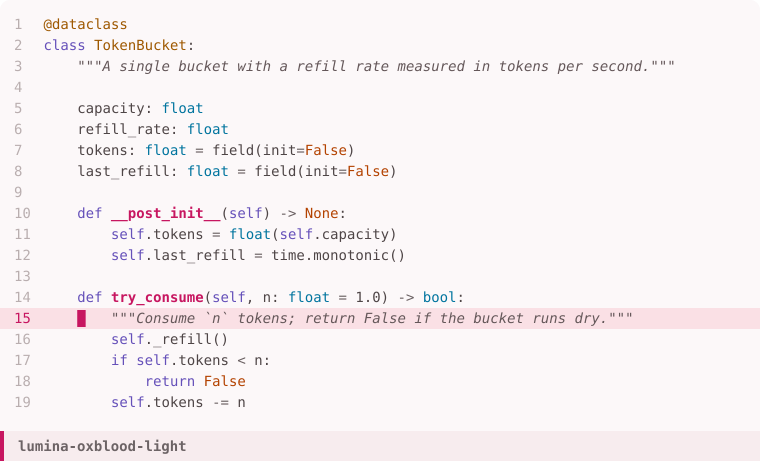

**Tide**

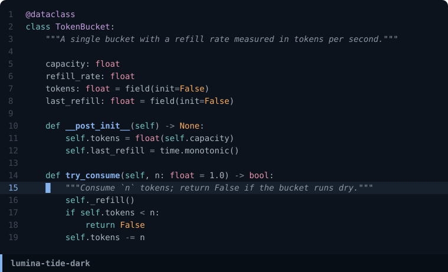 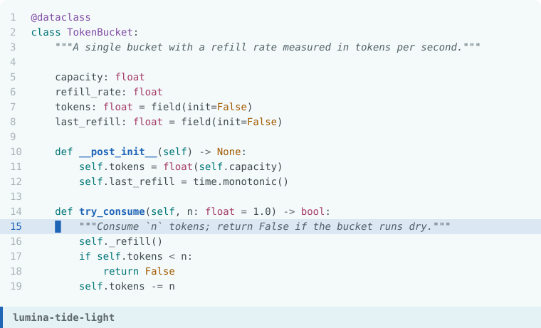

**Canopy**

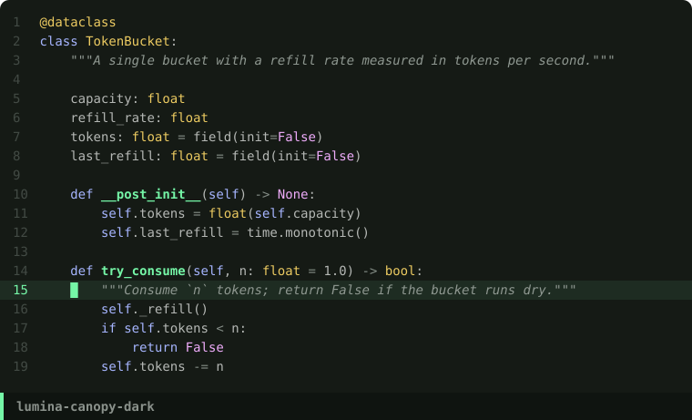 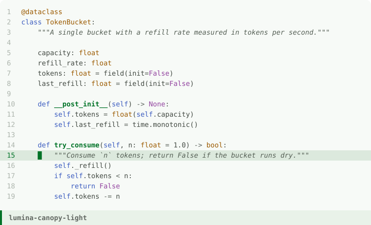

**Slate**

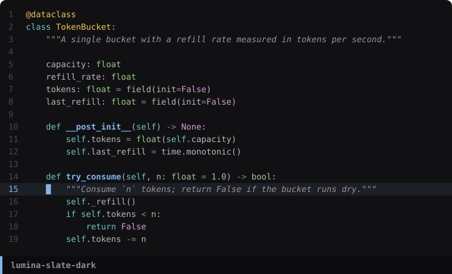 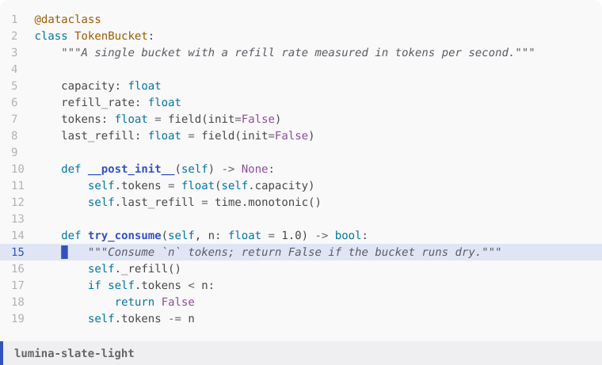

**Nocturne**

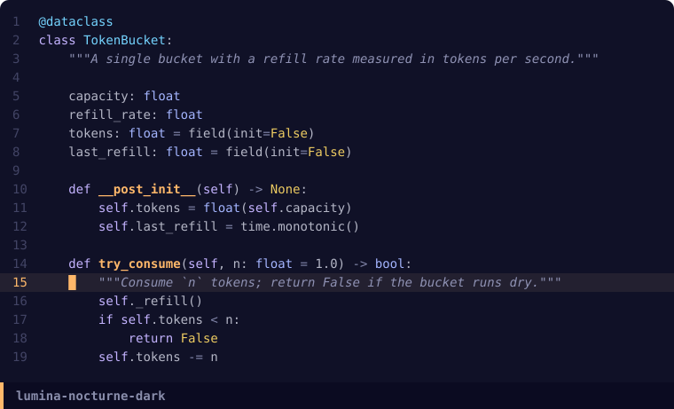 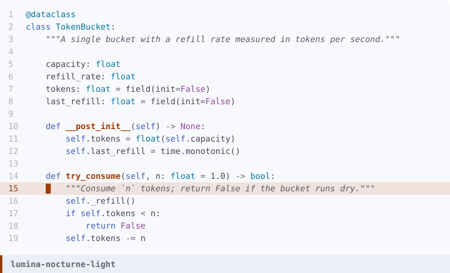

**Amethyst**

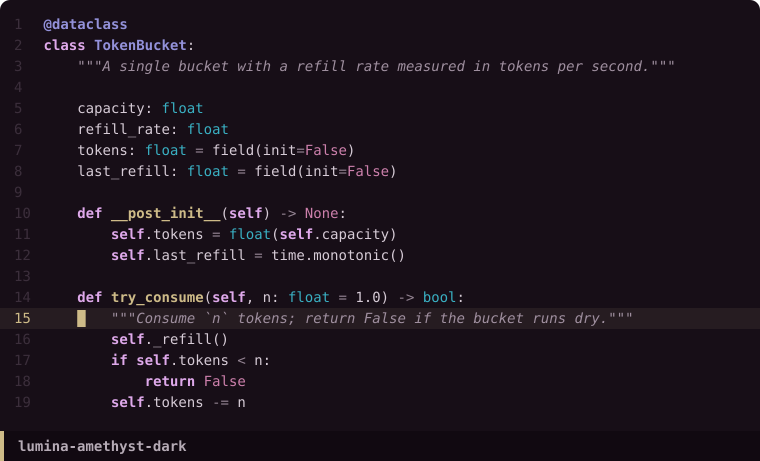 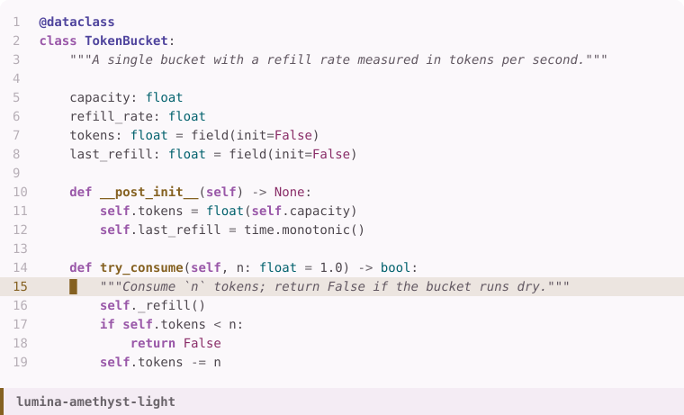

**Prisma**

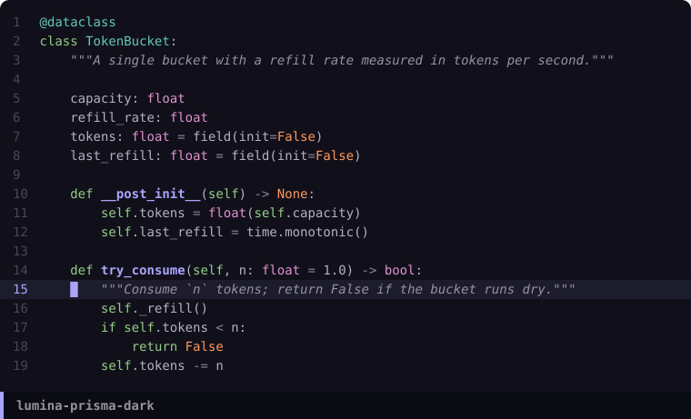 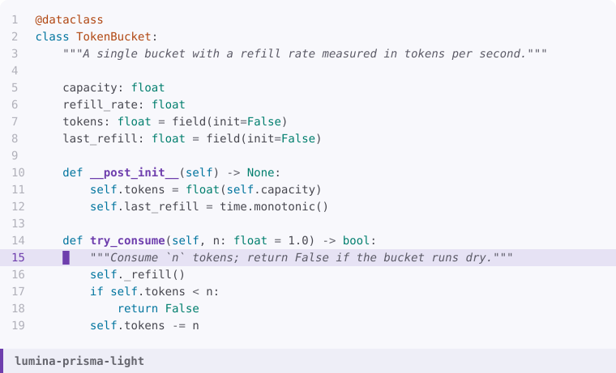

**Prisma ink** (black and white)

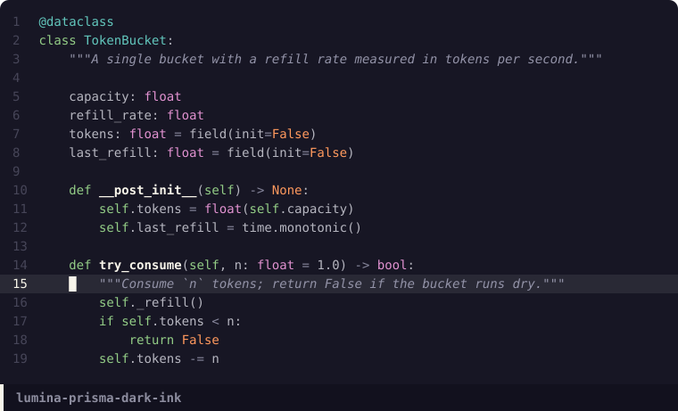 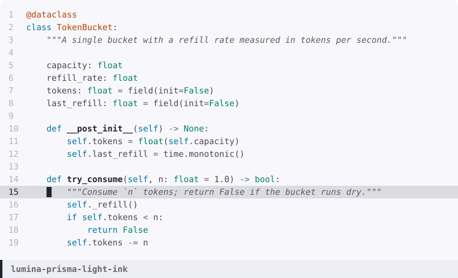

**Sirocco**

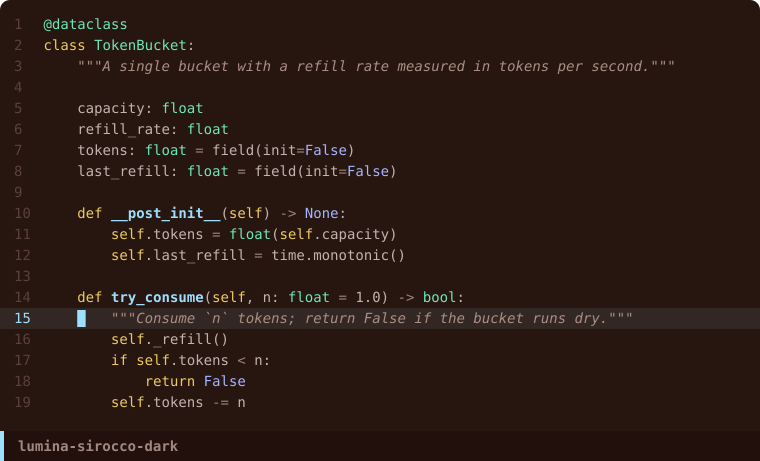 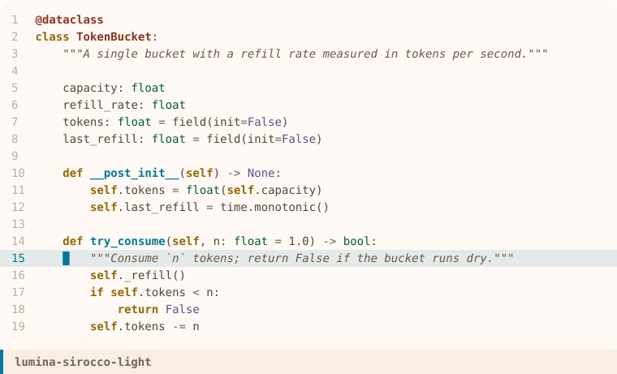

**Celadon**

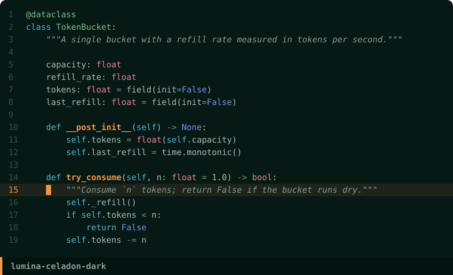 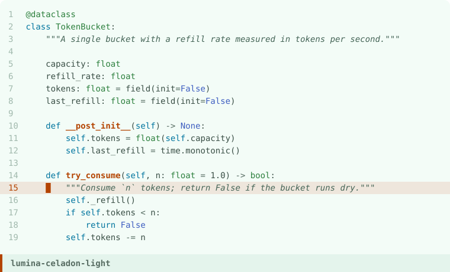

**Sumi**

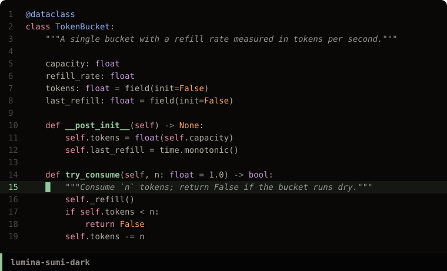 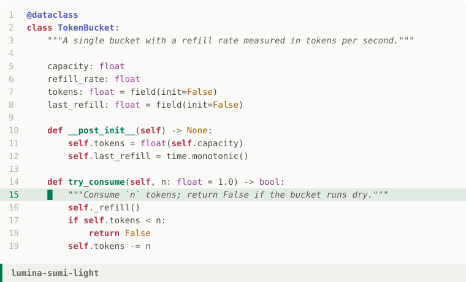

**Pivoine**

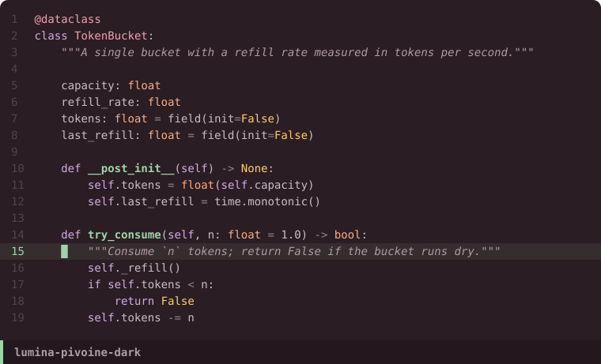 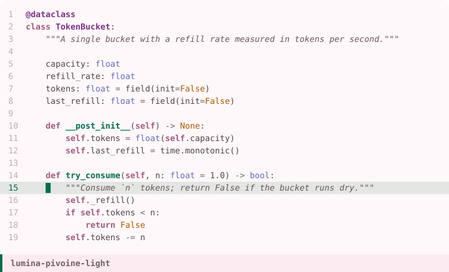

### Names

`lumina-<flavor>-<dark|light>` and `lumina-<flavor>-<dark|light>-contrast`,
for example `lumina-vesper-dark` or `lumina-dawn-light-contrast`.
Prisma adds black-and-white twins: `lumina-prisma-dark-ink`,
`lumina-prisma-light-ink` and their `-contrast` versions.

## Supported targets

| Target | Output |
|---|---|
| **Emacs** (vanilla `deftheme`)  | `emacs/themes/*.el` (68), close to 3 000 faces each |
| **Neovim** (Lua colorscheme)    | `nvim/colors/*.lua` (68), over 1 600 groups each, plus `nvim/lua/lualine/themes/*.lua` |
| **VS Code** (extension)         | `vscode/themes/*.json` (68): 565 workbench colours, 80 token scopes, 47 semantic tokens |
| **WezTerm** (color scheme)      | `wezterm/*.toml` (68): ANSI, indexed, tab bar states, copy and quick-select modes |
| **base24** (tinted-theming)     | `base24/*.yaml` (68) |

The Emacs files require no external dependency and load on a bare
`emacs -Q` in about ten milliseconds. Each one styles close to 3 000
faces across the core UI, built-in modes and some 180 packages (see
`generators/faces_src.py` for the full list, grouped by section); faces
of packages you do not use are simply ignored. `docs/showcase.html`,
built by `tools/preview/showcase.sh`, shows every theme on a full
interface mock whose colours are read back from Emacs.

## Install

### Emacs

Requires Emacs 26.1 or later.

**MELPA**:
```elisp
M-x package-install RET lumina-themes RET
M-x load-theme RET lumina-vesper-dark RET
```

**Doom** — `packages.el`:
```elisp
(package! lumina-themes :recipe (:host github :repo "RazikSF/lumina-themes"
                                 :files ("emacs/*.el" "emacs/themes/*.el")))
```
Then `config.el`:
```elisp
(require 'lumina-themes)
(setq doom-theme 'lumina-vesper-dark)
```

**`straight.el`**:
```elisp
(straight-use-package
 '(lumina-themes :type git :host github :repo "RazikSF/lumina-themes"
                 :files ("emacs/*.el" "emacs/themes/*.el")))
(load-theme 'lumina-vesper-dark t)
```

**`elpaca`**:
```elisp
(elpaca (lumina-themes :host github :repo "RazikSF/lumina-themes"
                       :files ("emacs/*.el" "emacs/themes/*.el")))
```

**Manual**: clone the repository and add `emacs/themes/` to
`custom-theme-load-path`:
```elisp
(add-to-list 'custom-theme-load-path "/path/to/lumina-themes/emacs/themes")
(load-theme 'lumina-vesper-dark t)
```

#### Customisation

Six optional variables, set them before loading a theme or call
`M-x lumina-themes-reapply` after toggling them:

```elisp
(setq lumina-themes-brighter-comments  nil)  ; bolder comments
(setq lumina-themes-comment-bg         nil)  ; tinted comment background
(setq lumina-themes-padded-modeline    nil)  ; t, or integer pixel width
(setq lumina-themes-italic-comments    t)    ; italic on comments
(setq lumina-themes-italic-types       nil)  ; italic on type names
(setq lumina-themes-bold-keywords      nil)  ; bold on keywords
```

`M-x lumina-themes-select` picks a Lumina theme with completion,
`M-x lumina-themes-toggle` switches between the dark and light twin of
the current one, and `M-x lumina-themes-load-random` loads a random
theme (prefix arg `C-u` restricts to dark, `C-u C-u` to light).

### Neovim

**`lazy.nvim`**:
```lua
{
  "RazikSF/lumina-themes",
  init = function()
    vim.opt.rtp:append(vim.fn.stdpath("data") .. "/lazy/lumina-themes/nvim")
  end,
  config = function() vim.cmd.colorscheme("lumina-vesper-dark") end,
}
```

**`packer.nvim`**:
```lua
use { "RazikSF/lumina-themes", rtp = "nvim" }
```

**`vim-plug`**:
```vim
Plug 'RazikSF/lumina-themes', { 'rtp': 'nvim' }
```

**Manual**: copy `nvim/colors/*.lua` into your Neovim runtime's
`colors/` directory, then `:colorscheme lumina-vesper-dark`.

Every colorscheme sets `vim.g.terminal_color_0..15` and covers the
core UI, tree-sitter captures, LSP semantic tokens, diagnostics and
some 70 plugins (telescope, fzf-lua, snacks, nvim-tree, neo-tree, oil,
nvim-cmp, blink.cmp, gitsigns, neogit, diffview, fugitive, flash, leap,
noice, notify, which-key, trouble, lazy, mason, dap-ui, neotest,
render-markdown, orgmode, mini.*, bufferline, barbar, lspsaga, navic and
more). A matching lualine theme ships for each flavor:

```lua
require("lualine").setup({ options = { theme = "lumina-vesper-dark" } })
```

### VS Code

**Marketplace**:
```
ext install RazikSF.lumina-themes
```
Then `Cmd/Ctrl-K Cmd/Ctrl-T` and pick a Lumina flavor.

**Manual `.vsix`**:
```sh
cd vscode && npx @vscode/vsce package
code --install-extension lumina-themes-2.1.0.vsix
```

### WezTerm

```lua
config.color_scheme_dirs = { "/path/to/lumina-themes/wezterm" }
config.color_scheme = "lumina-vesper-dark"
```

### base24 / tinted-theming

The `base24/` YAML files are standard tinted-theming schemes. Use them
with [tinty](https://github.com/tinted-theming/tinty),
[base16-shell](https://github.com/tinted-theming/base16-shell) or any
community template to theme terminals, `bat`, `fzf`, `btop` and the rest
of the CLI from a single source.

## Architecture

```
generators/v2_palettes.py   flavors composed from public scales (compose); signature, -contrast
tools/explore/              palette lab: sources.json, explore.py contact sheet, variants.py
spec/lumina.json            generated palettes (one per flavor/variant)
generators/faces_src.py     face design, grouped by package (edit this)
spec/faces.json             generated face mapping (~3 000 faces)
spec/variables.json         theme variables (hl-todo, vc-annotate, pdf-tools)
generators/nvim_src.py      Neovim highlight design, grouped by plugin (edit this)
spec/nvim_highlights.json   generated Neovim highlight mapping
spec/vscode.json            declarative VS Code workbench + tokens
generators/lumina_gen.py    spec -> all targets; embeds per-flavor schemas
emacs/themes/*.el           generated; pure vanilla deftheme
emacs/lumina-themes.el      Emacs package loader
nvim/colors/*.lua           generated, with nvim/lua/lualine/themes/*.lua
vscode/themes/*.json        generated
vscode/package.json         generated; bundles all flavors
wezterm/*.toml              generated
base24/*.yaml               generated
tools/preview/              Emacs batch renderer, gallery, showcase
tools/distance.py           perceptual distance between flavors
archive/                    fifteen retired flavors, restorable
Makefile                    make build / make check / make verify
```

Lumina is palette-first. `spec/lumina.json` carries one palette per
(flavor, mode); per-flavor syntax schemas live in
`generators/lumina_gen.py` as Python data (lead accent, rainbow /
outline / orderless sequences, modeline and vertico backgrounds, magit
and org mappings, preprocessor and escape slots — shared between dark
and light). The generator resolves palette references to literal hex
per flavor and emits one file per target per (flavor, mode).

A flavor is one `compose(...)` call in `generators/v2_palettes.py`:
ground, lamp slot, role map, optional hue overrides. It propagates to
all five targets on the next `make build`; a face edit in
`generators/faces_src.py` propagates to the 52 Emacs themes, one in
`generators/nvim_src.py` to the 52 Neovim colorschemes.

## Develop

Requires Python 3.11+.

```sh
make build       # spec -> all targets
python3 generators/v2_palettes.py   # OKLCH -> spec/lumina.json
make check       # contrast and lightness gate
make verify      # rebuild, check, and smoke-test every theme on vanilla Emacs
tools/preview/gallery.sh            # re-render assets/screens/*.svg
tools/preview/showcase.sh           # docs/showcase.html, full UI mock per theme
make extract     # one-time bootstrap from existing .el files (rarely needed)
```

## Contributing

Issues for color bugs — contrast on a specific UI surface, a face that
lands wrong, a missing package — are welcome.

Pull requests that add a flavor must justify its position on the hue
coverage map (does it fill a real gap, with a specific real-world
referent?), follow the single-lead discipline, and include a
screenshot.

Pull requests that retune existing colors should explain the intent and
include before/after captures.

## License

Licensed under the [MIT License](LICENSE).
